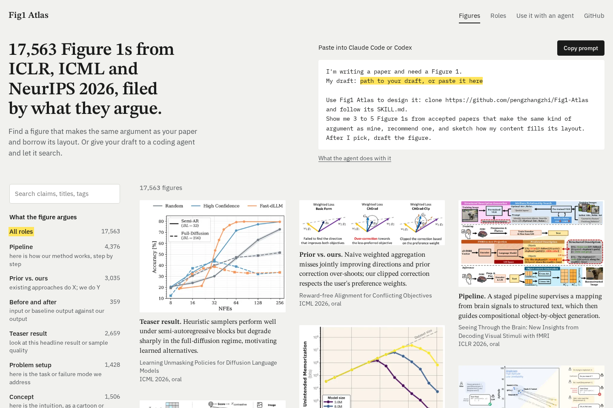

<h1 align="center">Fig1 Atlas</h1>

<p align="center">
  <b>17,563 Figure 1s from ICLR, ICML and NeurIPS 2026, filed by what they argue.</b><br>
  Hand your draft to Claude Code or Codex and get a Figure 1 modeled on accepted papers that made the same argument.
</p>

<p align="center">
  <a href="https://pengzhangzhi.github.io/Fig1-Atlas/"></a>
  <a href="https://huggingface.co/datasets/fredzzp/fig1-atlas"></a>
  <a href="SKILL.md"></a>
</p>

<p align="center">
  <a href="https://pengzhangzhi.github.io/Fig1-Atlas/"></a>
</p>

## Design your Figure 1

Open Claude Code or Codex in the folder that holds your draft and paste this. Notes or a one-paragraph idea work too.

```text
I'm writing a paper and need a Figure 1.
My draft: <path to your draft, or paste it here>

Use Fig1 Atlas to design it: clone https://github.com/pengzhangzhi/Fig1-Atlas and follow its SKILL.md.
Show me 3 to 5 Figure 1s from accepted papers that make the same kind of argument as mine, recommend one,
and sketch how my content fills its layout. After I pick, draft the figure.
```

The agent then:

1. **Reads your draft** and writes down the one claim Figure 1 has to make.
2. **Searches the atlas** for figures that make that kind of claim, and looks at them.
3. **Shows you 3 to 5 templates**, each with a link, why it fits, and what goes in each panel for your paper.
4. **Drafts the figure** you pick, in TikZ, matplotlib, SVG or slides.

No API key and no packages: the search is plain Python over a text index.

<details>
<summary><b>Example of what comes back</b> (a test draft on self-correcting masked diffusion language models)</summary>

The agent returned five templates with links and panel mappings, then this:

> **Recommendation: #1 (PRISM's layout), with the right panel swapped for your results.**
> - Two aligned token timelines make "frozen forever" against "revisable" visible at a glance.
> - Your best evidence is that most of the gain comes from the first 20% of steps. That fits the timeline
>   directly: the wrongly committed token sits near the top.
> - Your method has no training stage, so the right-hand panel goes to the numbers.

```text
(a) Standard MDLM          | (b) ReMask (ours)             | (c) Results
step 0   [M][M][M][M]      | [M][M][M][M]                  | PPL  42.1 → 27.8
step 5   [M][eat][M][..]   | [M][eat][M][..]               | (bars, 64 steps)
         wrong, committed  |  conf 0.2 ↓ re-mask (red)     | pass@1 31% → 44%
step 30  [..][eat][..]     | [..][M][..] → [have]          | "same NFE" tag
final    ✗ error persists  | ✓ corrected                   | gain from first 20%
```

> Which one should I draft? Also tell me what output you want: matplotlib/SVG, TikZ, or a slide-style PNG.

</details>

## Why "by what they argue"

The best template for your figure is rarely from your own subfield. A paper on one-step text generation should
look at image-distillation figures that argue "many steps become one". So every figure in the atlas is labeled
with its **role**, the argument it makes:

| Role | The figure argues | Figures |
|---|---|---:|
| Pipeline | here is how our method works, step by step | 4,376 |
| Prior vs. ours | existing approaches do X; we do Y | 3,035 |
| Analysis finding | we found this phenomenon | 2,821 |
| Teaser result | look at this headline result or sample quality | 2,659 |
| Concept | here is the intuition, as a cartoon or geometric picture | 1,506 |
| Problem setup | here is the task or failure mode we address | 1,428 |
| Overview | here are the parts of a system or benchmark and how they fit | 1,379 |
| Before and after | input or baseline output against our output | 359 |

Each entry also has a one-sentence claim, the layout, tags, style and a written description of what is drawn.
See examples of every role on the [Roles page](https://pengzhangzhi.github.io/Fig1-Atlas/roles.html).

## Other ways to use it

**Browse.** [pengzhangzhi.github.io/Fig1-Atlas](https://pengzhangzhi.github.io/Fig1-Atlas/) filters by role, venue, tier and style.
Every figure page has a prompt that makes that figure your template.

**Install as a Claude Code skill.** After this, "design my Figure 1" is enough.

```bash
git clone https://github.com/pengzhangzhi/Fig1-Atlas ~/.claude/skills/fig1-atlas
```

**Search by hand.**

```bash
python3 scripts/search.py --role prior-vs-ours --tags one-step,distillation --limit 20
python3 scripts/show.py iclr26-0566        # full entry
python3 scripts/fetch_fig.py iclr26-0566   # download the image
```

**Agents without a shell** can start from [llms.txt](https://pengzhangzhi.github.io/Fig1-Atlas/llms.txt).

## What's in the atlas

| Venue | Accepted papers | In the atlas | With image |
|---|---:|---:|---:|
| ICLR 2026 | 5,353 | 5,177 | 2,596 |
| ICML 2026 | 6,554 | 6,237 | 3,143 |
| NeurIPS 2026 | 9,002 | 6,149 | 4,009 |
| **Total** | **20,909** | **17,563** | **9,748** |

- **With image** means the paper's license lets us host the figure. The rest are text entries: role, claim,
  layout, description and a link to the PDF.
- **Not in the atlas yet:** 2,494 NeurIPS papers that are not on arXiv (they arrive with the NeurIPS
  proceedings) and 850 papers with no Figure 1 we could crop cleanly. [`data/missing.jsonl`](data/missing.jsonl) lists each one.
- **Labels are machine-written.** Roles, claims and descriptions come from a model and can be wrong. About 6%
  of image crops are flagged as imperfect in each entry's `qc_flags`.

<details>
<summary>Repository layout</summary>

| Path | What |
|---|---|
| `SKILL.md` | the agent workflow |
| `references/roles.md` | role definitions and how to tell them apart |
| `scripts/` | `search.py`, `show.py`, `fetch_fig.py` (standard library only) |
| `data/index.jsonl` | one line per paper: id, title, venue, tier, role, claim, layout, tags |
| `data/papers/<id>/meta.json` | abstract, caption, description, style, links, license, image URL |
| `pipeline/` | how the atlas is built, see [pipeline/README.md](pipeline/README.md) |
| `site/` | the website |

Images are in the Hugging Face dataset [`fredzzp/fig1-atlas`](https://huggingface.co/datasets/fredzzp/fig1-atlas).
</details>

## Licensing and takedown

Figures remain © their authors. Images are hosted only for papers whose arXiv license is CC BY, CC BY-SA, CC0,
CC BY-NC or CC BY-NC-SA, each with attribution; NC images are for non-commercial use, and so is this project.
Borrow a layout, not the artwork, and credit the paper you borrowed from.

The code and the project-written annotations are under the [MIT license](LICENSE).

**Authors:** to remove a figure or add one, [open an issue](https://github.com/pengzhangzhi/Fig1-Atlas/issues).
