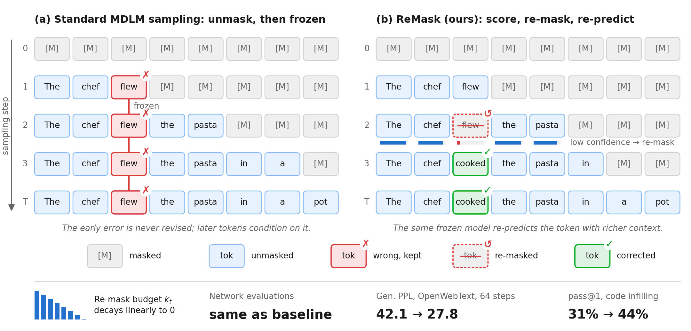

# Example run: a draft to a Figure 1 in two messages

A recorded Claude Code session. The draft is a made-up test paper, so its numbers are not real results.
Replay with the figures the agent looked at: https://pengzhangzhi.github.io/Fig1-Atlas/example.html

| File | What |
|---|---|
| `draft.md` | the input: an abstract and three lines of method notes |
| `prompt-1.txt` | first message, the standard Fig1 Atlas prompt |
| `answer-1.md` | the agent's answer: four templates, a recommendation, a sketch |
| `prompt-2.txt` | second message: the pick and the format |
| `answer-2.md` | the agent's notes on the draft figure |
| `fig1_remask.py`, `.png`, `.pdf` | the deliverable |

